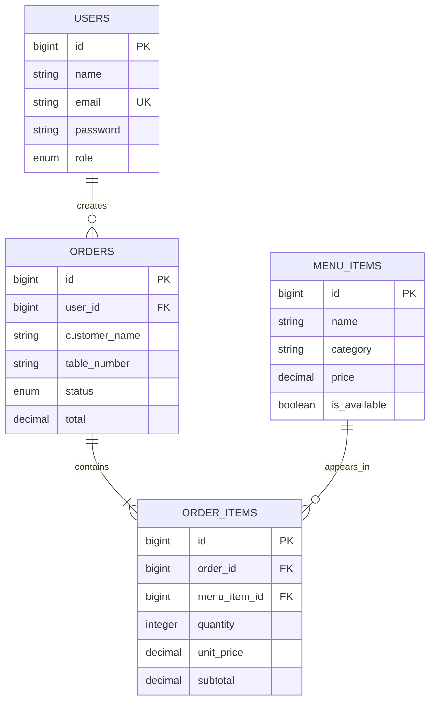

# Restaurant Management System ERD

`users` creates many `orders`. Each `order` contains one or more `order_items`. Each `order_item` refers to one `menu_item`; a menu item can be used in many order items. `order_items` stores the unit price at time of sale so later menu price changes do not alter old order totals.
